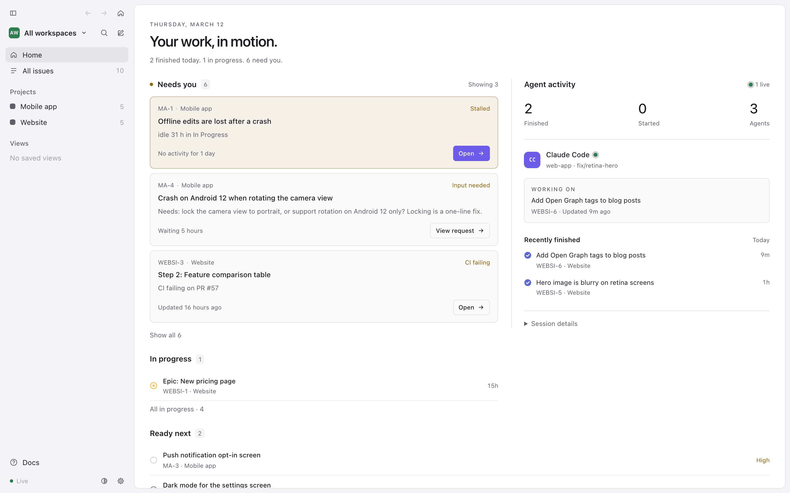

The UI comes in several themes, and you can add your own. The browser UI and the app window always show the same
theme: the choice is saved as `theme` in the data folder's `config.yml`, and every open window switches as soon as it
changes, without a reload.



## Switching

- **In the sidebar:** the theme icon at the bottom opens a menu of every theme, in the app and the browser.
- **In the app:** Settings (⌘,) ▸ Appearance ▸ **Theme**. A theme picked while the engine can't be reached is applied once
  it is reachable again, even after the app restarts.
- **In any window:** press ⌘K, type `theme`, and pick one. A query that starts with `theme` lists the themes first,
  so `theme paper` ⏎ goes straight to Paper. The current theme is marked *Current*; if the engine refuses a theme, the
  reason shows in the bar.
- **By hand:** set `theme:` in `config.yml` (for example `theme: light`). The engine picks up the edit.

| Theme | id | Notes |
|---|---|---|
| Graphite | `graphite` | The default: graphite grey with a sage-green accent. |
| Dark | `dark` | The original dark theme, neutral grey with a violet accent. |
| Light | `light` | |
| Match macOS | `system` | Dark or Light, following System Settings ▸ Appearance; it switches when macOS does. |
| Midnight | `midnight` | A blue-tinted dark theme. |
| Plum | `plum` | A warm purple dark theme. |
| Paper | `paper` | A soft off-white light theme with a green accent. |
| High contrast | `high-contrast` | Black background, white text, brighter borders. |

Graphite is shown when `config.yml` has no `theme`. A theme you picked stays picked, Dark included: a `config.yml`
that says `theme: dark` keeps Dark. New data folders start with `theme: graphite`.

Every built-in theme passes WCAG AA contrast (4.5:1) for body text and muted text on its backgrounds.

The app window's background and title bar follow the theme too, so a dark theme doesn't flash white when the window
opens. The menu-bar menu keeps the macOS look.

## Your own theme

A theme is a file in the data folder's `themes/` folder (create it if it isn't there). The file name, without `.yml`,
is the theme's id: `themes/ocean.yml` is `ocean`. Use letters, digits, `-` and `_` in the name, and not the id of a
built-in theme. Save the file and it shows up in Settings and ⌘K; edits apply as soon as you save. Adding, removing
or renaming the whole `themes/` folder is picked up too.

```yaml
# themes/ocean.yml
name: Ocean            # shown in Settings and ⌘K
base: light            # dark or light: sets the light/dark look and fills in every color you leave out
colors:
  bg: "#eef4fb"
  panel: "#ffffff"
  accent: "#0a6cff"
  link: "#0a5fd8"
  border: "#d6e2f0"
statuses:              # optional: recolor a status type's icon
  started: "#c98a00"
```

- `name` and `base` are required; `colors` and `statuses` are optional. A file named after a built-in id (for
  example an older `themes/plum.yml`, from before Plum was built in) isn't loaded: it shows as a file that can't be
  read, and renaming it (`themes/my-plum.yml`) brings it back. The `name` must differ from the built-in
  themes' names and from every other theme file's, ignoring case: when two files share a name, the first by file
  name loads and the other is reported. A color you leave out takes the base
  theme's value, so a theme can be as small as one color.
- Colors are `#rgb`, `#rrggbb` (with optional alpha, `#rrggbbaa`), `rgb(…)`/`rgba(…)` or `hsl(…)`/`hsla(…)`. Quote hex
  colors: YAML reads an unquoted `#` as a comment.
- `statuses` keys are status types, not status names: `backlog`, `unstarted` (Todo), `started` (In Progress and
  Waiting, which keep their different [icons](/docs/use/daily-use/#status-icons)), `completed` (Done, and a full
  progress ring), `canceled`, `duplicate`. An override replaces the color from `config.yml` for every
  status of that type while the theme is on. Light uses this for Backlog and Todo, whose default colors are too pale
  on white.
- Only the keys and token names below are accepted, and only colors as values. A file that breaks a rule isn't
  applied: it shows in the sidebar as a file that can't be read, with what to fix, and the other themes still work.
  If the chosen theme's file is removed or broken, the UI shows Graphite until it's back (`config.yml` keeps its id).
  Picking a theme in Settings or ⌘K replaces that id, so the theme doesn't jump when the file returns.

### Color tokens

A token may also be written with its CSS name (`--bg`).

| Token | What it colors |
|---|---|
| `bg` | the page behind the panels, and the sidebar; also the check and dash inside the Done and Canceled icons |
| `panel` | the main panel, menus and dialogs |
| `hover` | a row or button under the pointer |
| `active` | the selected row, a pressed menu item |
| `card` | view cards |
| `card-hover` | a card under the pointer |
| `group-bg` | group headers in lists and board rows |
| `lane` | board lanes |
| `code-bg` | inline code in descriptions and comments |
| `pre-bg` | code blocks |
| `border` | panel and control borders |
| `divider` | the thin lines between rows |
| `pill-border` | the outline of pills (labels, branches) |
| `border-focus` | the comment box while you type |
| `text` | body text; at 18% it is the track of the progress ring |
| `text-strong` | a document title under the pointer |
| `muted` | secondary text |
| `faint` | the least important text and empty-state hints |
| `id` | issue ids |
| `pill-text` | text in pills |
| `link` | links in descriptions and comments |
| `on-accent` | text on accent-colored buttons and avatars |
| `accent` | primary buttons, focus rings, checked items, the progress ring's arc |
| `accent-wash` | a board column or cell while you drag an issue over it |
| `warn` | Needs-you reasons, the Needs you heading and the waiting request's status on Home |
| `danger` | errors, Blocked, delete buttons, failing checks |
| `danger-border` | the outline of the STALLED pill and closed PRs |
| `danger-border-soft` | the outline of an overdue date |
| `ok` | Ready next, open PRs, passing checks |
| `ok-border` | the outline of an open-PR pill |
| `merged` | merged PRs |
| `merged-border` | the outline of a merged-PR pill |
| `in-progress` | the In progress heading on Home |
| `urgent` | the Urgent priority icon |
| `star` | a favorite view's star |
| `avatar` | your avatar in comments |
| `agent` | agents' avatars and the workspace badge |
| `switch-off` | a switch that is off |
| `switch-off-hover` | an off switch under the pointer |
| `switch-knob` | a switch's knob |
| `shadow` | menu and popover shadows |
| `shadow-strong` | dialog shadows |
| `overlay` | the dimmed page behind a dialog or ⌘K |
| `tile-shadow` | the text shadow on project tiles in the collapsed sidebar |
