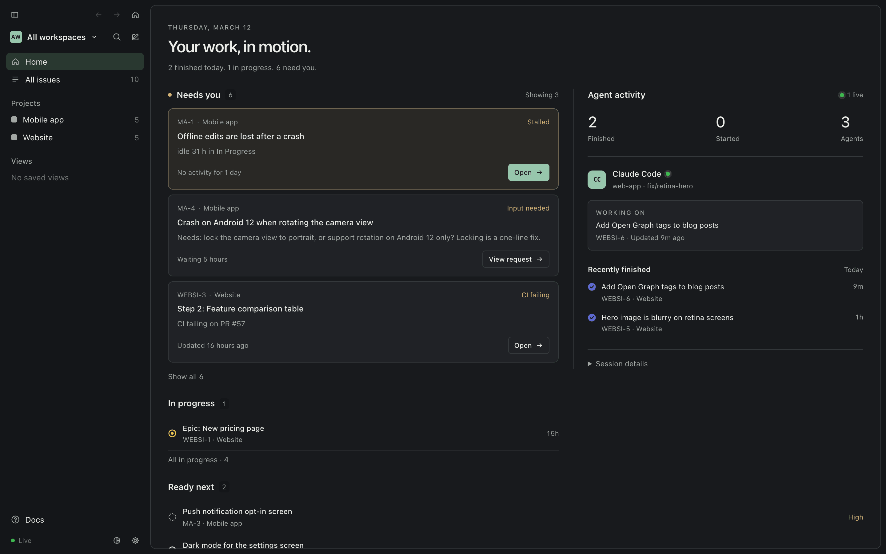

import { Card, CardGrid } from '@astrojs/starlight/components'

AI Task Tracking runs as a menu-bar app with a window of Home, lists, boards and projects, and agents reach
it through an MCP server named `ai-task-tracking`: Claude Code, Codex CLI, Cursor, VS Code, Windsurf, Gemini CLI and
Claude Desktop. Agents file issues, plan epics with steps, comment as they work and hand decisions back to you; Home
shows what needs you and a live feed of every change, tagged with the repo and branch it came from. Everything is
plain Markdown and YAML files in a folder on your Mac (a git repo), optionally backed up to a private GitHub repo.

<CardGrid>
  <Card title="Menu-bar and Dock app" icon="laptop">
    Home with *Needs you*, *In progress*, *Ready next*, *Blocked* and a live feed of agent activity. Global shortcuts
    for the window and Quick Capture. See [Daily use](/docs/use/daily-use/).
  </Card>
  <Card title="The aitt CLI" icon="seti:shell">
    `aitt setup` connects everything; `aitt open ATT-1` jumps to an issue; `aitt guidance` prints the agent
    instructions. See [First run](/docs/start/first-run/).
  </Card>
  <Card title="MCP server for agents" icon="puzzle">
    One server, `ai-task-tracking`, for Claude Code and every other MCP-capable tool. See
    [Using with agent tools](/docs/use/agent-tools/).
  </Card>
  <Card title="Plain files you own" icon="document">
    Markdown and YAML in a git repo, committed on every change and optionally pushed to a private GitHub repo. See
    [Where data lives](/docs/maintain/where-data-lives/) and [Data model and importing](/docs/use/data-model/).
  </Card>
</CardGrid>
