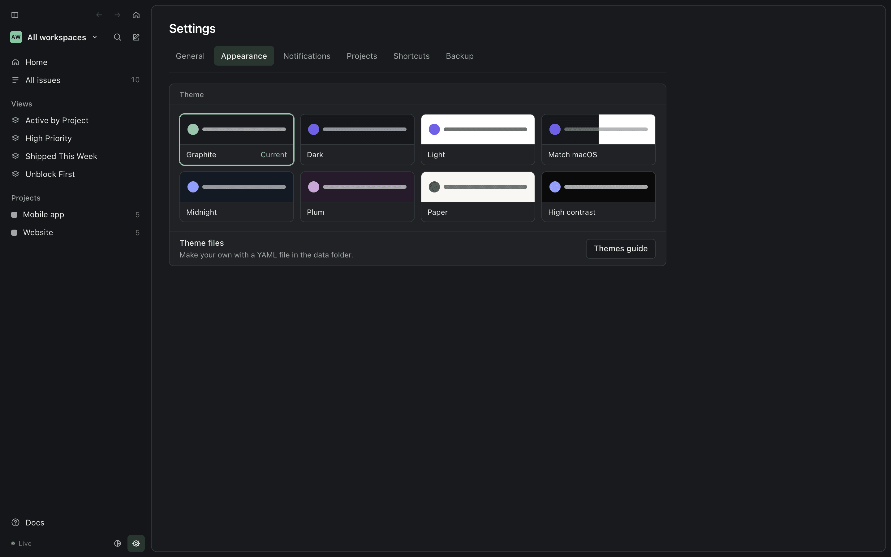

## Menu bar

The AI Task Tracking icon in the menu bar has:

- **Open AI Task Tracking**, **New Issue**, **Quick Capture…**
- the engine status and the backup status, and **Back Up Now**
- **Settings…** (⌘,), **Help** (these docs, in the app window), **Launch at Login**, **Quit AI Task Tracking**

It also lists the issues that need you, with a link to show them all on Home (Settings can hide them).

## Dock

The app also shows in the Dock and the app switcher by default. Clicking the Dock icon when no window is open opens
the window. Turn off **Settings ▸ Show in the Dock** to keep it in the menu bar only.

## Global shortcuts

Shortcuts work system-wide:

| Shortcut | Action | Other choices in Settings |
|---|---|---|
| ⌥⌘I | open the window | ⌃⌥⌘I, ⌥⌘T |
| ⌥⌘N | Quick Capture | ⌃⌥⌘N, ⌥⇧⌘N |

Change them or turn them off in Settings.

## Settings

Settings is a page in the main window: the gear at the bottom of the sidebar, in the app and in a browser (`#/settings`,
or `#/settings/appearance` for one tab). In the app, ⌘, **Settings…** in the menu and `aitt://settings` open it too.
Every change applies straight away, and an open page follows changes made elsewhere.



- **General**: the status of the engine (and where your data is), the backup and the last agent write. Launch at login;
  Show in the Dock; Show Needs-you issues in the menu; Show stalled work in Needs you (see [Stalled work](#stalled-work));
  Show CI status (see [CI status](#ci-status-on-pull-requests)).
- **Appearance**: a card for every theme, including Match macOS and your theme files; see
  [Themes](/docs/guides/themes/).
- **Notifications**: Notify me about agent activity, and for which events: an agent needs me (Waiting, Needs
  decision/review, stalled), an agent finished an issue (Done), an agent created an issue (off by default).
- **Projects**: one switch per project (and No project); see [Hidden projects](#hidden-projects). The tab shows how many
  are hidden.
- **Shortcuts**: the two global shortcuts above.
- **Backup**: Back up to GitHub before quitting. When off, quitting still commits your changes; it just doesn't wait
  for the push. **Back up now** does it straight away.

**In a browser**, Appearance and Projects work as they do in the app, because they're saved in `config.yml`. Everything
else is stored by the app on this Mac, where the engine can't read it, so its rows say *Only in the app*.

**When the engine can't be reached**, ⌘, opens a small window instead: the engine's status, a button to try starting
it, what to do if that fails, and Launch at login. It switches to the page once the engine answers. Every setting and
its default: [the Settings reference](/docs/reference/settings/).

## In the window

**Home** is a daily overview. At the top: today's date and one line, such as *12 finished today. 5 in progress.
3 need you.* Below it, in two columns (one on a phone: Needs you, In progress, Agent activity, Ready next):

- **Needs you** comes first: issues waiting for your decision or review, work that has [stalled](#stalled-work), and
  work whose [PR checks fail](#ci-status-on-pull-requests). Each request shows its issue and project and why it needs
  you (*Input needed* for Waiting, *Needs review*, *Needs decision*, *Stalled* or *CI failing*). An issue that waits on
  you by status or label also shows what it asks: the newest comment that isn't your own, so your reply doesn't replace
  the question. A stalled or failing reason shows too. It says how long the issue has waited: *Waiting 3 days* since it
  last moved to Waiting (or was created there), else how long it has been quiet (*No activity for 7 days*). **View
  request**, **Review** or **Open** opens the issue, and so does its title; stalled-only and CI-only work shows **Open**.
  The first request is highlighted. Home shows three; **Show all** lists the rest.
- **In progress** and **Ready next**: the first three of each, with how long ago an issue in progress last changed,
  and *Urgent* or *High* and *Unblocks N* (how many open issues wait on it) on ready ones. **All in progress** and
  **All ready** open the full lists in All issues, with their counts. Those can be higher than the section's, since
  stalled and CI-failing issues show in Needs you instead.
- **Blocked work**, folded under Ready next: click it to see the dependency chains, the first blocker first
  (*WEB-12 Plans config → WEB-13 Comparison table → WEB-14 FAQ*), and **All blocked**. Issues that block each other show as one chain marked as a cycle.
- **Agent activity**, beside the queue (below).
- **Plan**: your Now, Next and Later board; drag issues between the columns.

### Agent activity

The column on the right tells you what your agents got done today, not every write they made.

- **Today's counts**: issues finished, issues started and not finished yet, and the agent sessions that worked (with
  how many are writing now). Click a count to open Session details on just those.
- **The session at work**: the live agent session (or the latest one today), its repo and branch, and the issue it is
  working on, with when it last wrote.
- **Recently finished**: the last three issues finished today.
- **Session details**, folded: click it for the whole story.
  - **Today / 7 days** switches the range. A strip shows when agents worked, colored by tool: for Today, one bar per
    hour from midnight (hours still to come stay blank); for 7 days, one bar per day. The chips show Everything,
    Finished, Started, With notes or Needs you (issues an agent handed back to you in this range).
  - **One card per agent session**: the tool (Claude Code, Codex, Cursor…, or "Agent in" and the repo, such as "Agent
    in web-app", when the tool wasn't recorded), the repo and branch, when it ran, how many writes it made, and a green
    dot while it's still writing (within the last 10 minutes). Click the header to fold a card; a long card shows its
    first 10 rows and **Show N more**. Your own changes, from the app, the browser or by hand, share one **You** card
    per day. Days separate the cards (Today, Yesterday, then dates).
  - **One row per issue**: its status icon, id and title, and the path it took in that session (Backlog → In Progress
    → Done; "created" when the session created it). Internal writes, such as a plan change, fold away. The latest note
    shows as a one-line quote; click it (or press Enter on it) to read it all. GitHub PR and commit links in the notes
    become chips. Sub-issues touched in the same session sit under their epic, which shows its progress ring. Click a
    row to open the issue; a deleted issue's row is struck through.

Hidden projects stay out of all of it.

All issues, projects and saved views are in the sidebar, as lists or boards. At the top of the sidebar:

- **←** and **→** go back and forward through this window's own history (its pages in the app), and are greyed out
  when there's nowhere to go there. ⌘[ / ⌘], the mouse side buttons and a two-finger swipe use the same history, and
  also cross between the docs pages and the app.
- **⌂** goes Home.
- the sidebar button on the left collapses the sidebar to icons, and expands it again. So do ⌘\ and
  **View ▸ Toggle Sidebar** in the app. Collapsed, each icon shows its name when you point at it; projects show their
  initials. The sidebar stays the way you left it, and collapses on its own in a narrow window.

The app adds four saved views to your data folder the first time the engine starts, on a new folder or an existing one:

| View | Shows | Laid out as |
|---|---|---|
| **Active by Project** | issues in a started status, leaving out the ones that wait for you (Waiting) | board, by project |
| **Unblock First** | open issues that block other open issues | list, by priority |
| **High Priority** | open Urgent and High issues | board, by project |
| **Shipped This Week** | issues in a completed status, closed in the last 7 days | list, by project, newest close first |

They use the status names in your `config.yml` when they are added; if you rename a status later, edit the view too.
They are ordinary files in `views/`: change
one and save it, or delete its `.yml` file and it stays deleted. A view you already have with the same file name or the
same name is left as it is, and that default isn't added. `views/.default-views-offered` lists what has been offered;
remove a line to be offered that view again at the next start.

**Closed in the last N days** (the filter menu, under **Dates**) is a window that moves with today. It shows only closed
issues, by when they were closed: a later comment doesn't bring an issue back, reopening one takes it out, and a canceled
issue that is then finished counts from when it was finished. With no
**Status** filter, canceled and duplicate issues count as closed too. Issues closed before the activity log began, or
on another Mac, go by their last update unless they were imported with a close date. The **Completed issues** display
option has no effect on a view with this filter, as on a view that names statuses.

**Docs** at the bottom of the sidebar, **Help ▸ AI Task Tracking Help** (⌘?) in the app's menu and **Help** in the
menu-bar menu open these docs, which the app serves at `http://127.0.0.1:7477/docs/`; from a terminal, `aitt docs`
opens them in the browser.


A project shows its description, milestones and documents above its issues, grouped by status:


Click the ID at the top of an issue page to copy it.

An issue page has the description (checklists included), sub-issues, its attempts ("3 attempts · 2 tools": one per
agent session, which opens into each session's tool, repo, branch, writes and the status it left the issue in), the
activity with each agent's repo and branch, and the properties and relations on the right. Attempts start when this
Mac's activity log does (see [Picking up where a session stopped](/docs/guides/agent-sessions/#picking-up-where-a-session-stopped)):


| Key | Action |
|---|---|
| `c` | new issue |
| `/` or ⌘K | search |
| `g` then `h` | Home |
| `g` then `i` | all issues |
| ⌘[ / ⌘] | back and forward (also mouse side buttons and a two-finger swipe) |
| ⌘\ | collapse or expand the sidebar |


⌘K also switches the theme: type "theme" and pick one (see [Themes](/docs/guides/themes/)).

### Status icons

Every issue is a circle. An outline means the issue is open, a solid disc means it's closed, and the shape tells
you the status, so you can tell them apart even when a theme gives two statuses the same color.

| Icon | Status | Meaning |
|---|---|---|
| <svg width="16" height="16" viewBox="0 0 14 14" aria-hidden="true"><circle cx="7" cy="7" r="5.5" fill="none" stroke="currentColor" stroke-width="1.6" stroke-linecap="round" stroke-dasharray="0.001 2.879" transform="rotate(-90 7 7)"/></svg> | Backlog | a ring of dots: not committed to yet |
| <svg width="16" height="16" viewBox="0 0 14 14" aria-hidden="true"><circle cx="7" cy="7" r="5.5" fill="none" stroke="currentColor" stroke-width="1.5"/></svg> | Todo | an empty ring: committed, nobody on it yet |
| <svg width="16" height="16" viewBox="0 0 14 14" aria-hidden="true"><circle cx="7" cy="7" r="5.5" fill="none" stroke="currentColor" stroke-width="1.5"/><circle cx="7" cy="7" r="2.25" fill="currentColor"/></svg> | In Progress | a ring with a dot: someone is on it. Any started status you add gets this icon too |
| <svg width="16" height="16" viewBox="0 0 14 14" aria-hidden="true"><circle cx="7" cy="7" r="5.5" fill="none" stroke="currentColor" stroke-width="1.5"/><path d="M5.75 5.1v3.8M8.25 5.1v3.8" stroke="currentColor" stroke-width="1.5" stroke-linecap="round"/></svg> | Waiting | a ring with pause bars: stopped, it needs you. Every status listed under `needsYou.statuses` in `config.yml` (for example In Review) gets this icon |
| <svg width="16" height="16" viewBox="0 0 14 14" aria-hidden="true"><mask id="si-done"><rect width="14" height="14" fill="white"/><path d="M4.4 7.2 6.2 9 9.7 5.3" fill="none" stroke="black" stroke-width="1.5" stroke-linecap="round" stroke-linejoin="round"/></mask><circle cx="7" cy="7" r="6.25" fill="currentColor" mask="url(#si-done)"/></svg> | Done | a disc with a check: finished |
| <svg width="16" height="16" viewBox="0 0 14 14" aria-hidden="true"><mask id="si-canceled"><rect width="14" height="14" fill="white"/><path d="M4.6 7h4.8" stroke="black" stroke-width="1.5" stroke-linecap="round"/></mask><circle cx="7" cy="7" r="6.25" fill="currentColor" mask="url(#si-canceled)"/></svg> | Canceled | a disc with a dash: decided against |
| <svg width="16" height="16" viewBox="0 0 14 14" aria-hidden="true"><circle cx="8.6" cy="5.4" r="4.4" fill="none" stroke="currentColor" stroke-width="1.3" opacity=".75"/><circle cx="5.9" cy="8.1" r="4.9" fill="currentColor"/></svg> | Duplicate | a disc in front of a second circle: the same as another issue |

An issue with sub-issues also shows a **progress ring** and the count, such as
<svg width="14" height="14" viewBox="0 0 14 14" aria-hidden="true"><circle cx="7" cy="7" r="5.25" fill="none" stroke="currentColor" stroke-opacity=".18" stroke-width="2"/><circle cx="7" cy="7" r="5.25" fill="none" stroke="currentColor" stroke-width="2" stroke-linecap="round" stroke-dasharray="14.493 32.987" stroke-dashoffset="-1" transform="rotate(-90 7 7)"/></svg> 3/6,
in lists, on board cards and on the issue page. A project page uses the same ring for the whole project, in its
header, and for each milestone, counting that milestone's issues. Point at it to read "3 of 6 sub-issues done".
The ring fills clockwise from 12 o'clock. Any progress shows at least a short arc, the ring stays open until every
sub-issue is closed, and it closes in the Done color when they all are. It's the only icon that fills up; the
issue's own status icon still tells you whether the issue itself is closed.

## Hidden projects

Hide a project you don't want to see right now: turn on its switch in **Settings ▸ Projects**, or click **Hide project**
on its page. **No project** in that list hides the issues that have no project; it has no page, so only Settings can
hide it. The choice is saved as `hiddenProjects` in `config.yml`, so the app window and the browser always agree.

A hidden project appears nowhere except by direct link. Its issues leave the sidebar, All issues, Home (Needs you, In
progress, Ready next, Blocked work), saved views, the board, the activity feed and every count: a visible epic's sub-issue
count and progress ring leave hidden sub-issues out (with only hidden ones, it shows no ring), and Home's "unblocks"
and "blocked by" name only visible issues. Filters and grouping stop offering the project, and any label, milestone
or workspace that only it uses. ⌘K search leaves its issues out, and so do the menu-bar number, the menu's Needs-you
list, quick capture's project list and notifications. While No project is hidden, quick capture doesn't offer it
either.

Hiding only changes what *you* see:

- **Links still open it.** An issue link (`#/issue/ATT-12`, `aitt://issue/ATT-12`), the project's page and an exact
  issue id typed in ⌘K open as usual, with a quiet "This project is hidden" line and **Unhide**. A hidden issue's own
  page shows its real sub-issues and parents.
- **A visible issue names hidden ones by id only.** Its sub-issues, parents (in the breadcrumb), blockers and related
  issues that are hidden show the id and "in a hidden project", and open it.
- **Agents see no change.** Every agent tool returns hidden projects' issues as before. Hiding is a view setting, not
  access control. Requests marked as coming from an agent can't hide or unhide a project, but that is a header
  check, not enforcement: any program on this Mac can still read the data folder or ask the engine.
- **Unhiding brings everything back straight away**, in every open window, without a reload. Hiding the project of
  the page you're on keeps you on it.
- A saved view filtered to a hidden project says so ("Filtered to a hidden project") instead of looking empty.

## Stalled work

Work can stall without anyone saying so: an agent session ends mid-task, or an issue keeps bouncing between agents.
The engine checks every open issue each time Home, the menu bar or an agent asks, and flags it as **stalled** when:

- **Idle**: it is *In Progress* and nothing changed on it (no edit and no comment, by anyone) for 24 hours or more.
  An epic's work happens in its children, so for an issue with sub-issues a change to any of them, at any depth,
  counts too. An epic whose open sub-issues all need you (Waiting, or a Needs-you label), are blocked, or are epics
  waiting the same way, is waiting on them, not idle.
- **Churning**: in the last 7 days it was reopened (back to *In Progress* from Done, Canceled, Duplicate, Todo or
  Backlog, after having been in progress before) 2 times or more, or more than 3 different agent sessions worked on it
  since it was last Done. Going to *Waiting* (or another Needs-you status) and back is an agent asking you, and never
  counts as a reopen.

Done, Canceled and Duplicate issues are never stalled, churning skips issues parked in *Backlog*, and an issue with an
open blocker stays in *Blocked*: it is waiting, not stalled. Any edit or comment clears *idle*. Done clears *stalled*
while the issue stays done, but reopening it counts as a reopen, so an issue that keeps coming back from Done can be
churning again at once; the count drops as the reopens age out of the 7 days.

A stalled issue joins **Home ▸ Needs you** with a red **STALLED** mark and the reason, such as
`idle 31 h in In Progress` or `reopened 3× in 7 days by 4 sessions`. If it already needed you (Waiting, or a Needs
label), it keeps that reason and gets the mark as well. On the Now/Next/Later board its card says *stalled*.

Agents see it too: in `whats_next` stalled issues stay in their usual list (*needsYou* still means waiting on you)
with `stalled: <reason>`, and a short `stalled` list shows the ones their repo worked on; `get_issue` includes
`stalled: <reason>`.

**Tune it** in the data folder's `config.yml` (the engine picks up the change at once):

```yaml
stalled:
  idleHours: 24   # In Progress with no change for this long; 0 turns idle off
  windowDays: 7   # how far back churning looks; 0 turns churning off
  reopens: 2      # back to In Progress this many times in the window; 0 turns it off
  sessions: 3     # more than this many agent sessions in the window without Done; 0 turns it off
```

The churning rules read the engine's activity log (`.tracker/events.jsonl`), which is kept on this Mac only; on a
fresh clone they start counting from then. All keys: [config.yml reference](/docs/reference/config/).

**In the app**, Settings ▸ **Show stalled work in Needs you** (on by default) decides whether stalled issues count in
the menu-bar number, appear in the menu's Needs-you list and send notifications ("Stalled: ATT-12", once per issue
until it stops being stalled; a round trip through Waiting doesn't notify again). Turned off,
the app leaves out issues that are there *only* because they stalled; Home in the window still marks them, so you can
look when you choose to.

## CI status on pull requests

When an issue links a GitHub pull request (agents add `PR #12` links when they mention a PR URL), the engine checks
that PR with your own `gh` and shows its state (**open**, **draft**, **merged**, **closed**) and its checks
(**passing**, **failing**, **running**, **no checks**):

- **The issue page**: under each PR link, a badge with the state, the checks, the names of up to three failing checks
  and when it was last checked. A merged PR whose checks failed reads **merged · checks failed**. A PR your `gh` can't
  read says *CI status: no access with gh* under its link.
- **Rows** in lists, boards and Home: a small dot on issues that have a PR, red when checks fail, amber while they run,
  green when they pass. Point at it for the PR number and state.
- **Home ▸ Needs you**: an *In Progress* issue, or one that reached *Done* in the last 7 days, whose open (or draft)
  PR's checks fail joins Needs you with the reason, such as `CI failing on PR #12`. A merged or closed PR never puts
  an issue in Needs you; its badge still shows how its checks ended.
- **Agents**: `get_issue` adds `ci: { state, checks, failing }` to each PR link, and `whats_next` marks those items
  with `ci: "CI failing on PR #12"`.

The engine checks in the background, never while you wait: an open PR every 2 minutes, and a new PR link within a
second. A merged PR whose checks passed (or that has none) and a PR closed without merging are checked once more,
then never again; a merged PR whose checks failed or still run is re-checked every 30 minutes until 24 hours after
the merge. It only looks at PRs on open issues and on issues that reached Done in the last 7 days, runs at most 3
`gh` calls at once, and backs off on errors and rate limits. Nothing is checked in the first 5 seconds after the
engine starts, so the app can pass its setting first. The results are kept in `.tracker/ci.json` on this Mac (not in
your issue files), so a restart doesn't check everything again. The engine finds `gh` on its PATH, or in
`/opt/homebrew/bin`, `/usr/local/bin` or `~/.local/bin` (the app started at login has a short PATH).

Without `gh`, or signed out, issues show no CI status and nothing else changes; the reason is in `/api/health`
(see [Troubleshooting](/docs/maintain/troubleshooting/)). A link your `gh` can't read only affects that link.

**Turn it off** with Settings ▸ **Show CI status** in the app, or `enabled: false` in `config.yml`. Either way the
engine stops running `gh`, and no badges or failing-CI Needs-you entries appear (the app passes its setting to the
engine, which is what runs `gh`). Running the engine without the app (`aitt serve`), only `config.yml` decides.
`refreshMinutes` sets how often open PRs are re-checked:

```yaml
ci:
  enabled: true
  refreshMinutes: 2
```

## Links to issues

Agents print issues as `[ATT-1 Title](http://127.0.0.1:7477/#/issue/ATT-1) · aitt://issue/ATT-1`. The `aitt://`
link opens the app. From a terminal, `aitt open ATT-1` (or a project slug, or either link) does the same, falling
back to the browser when the app isn't installed.
