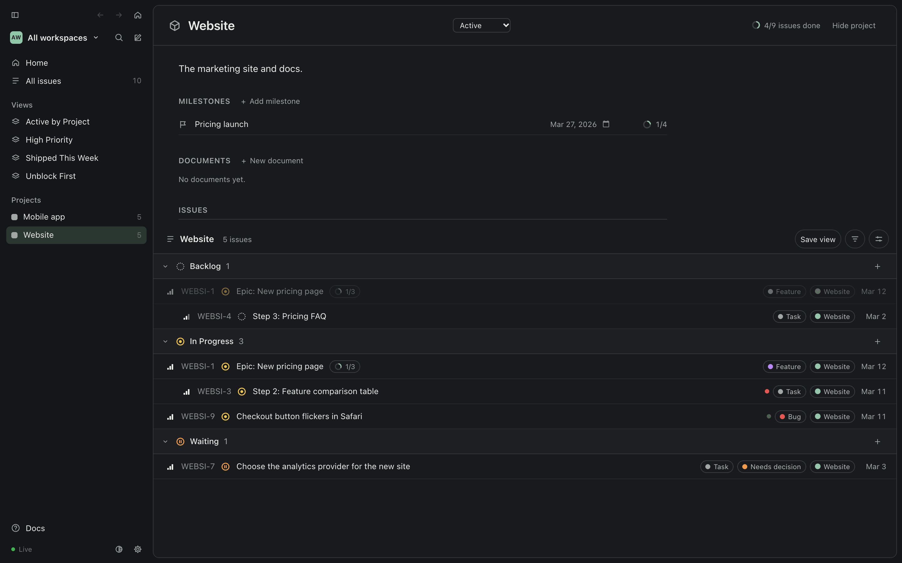
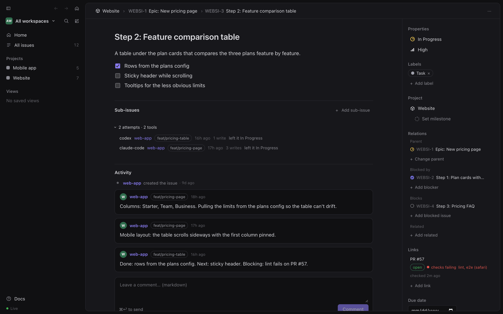
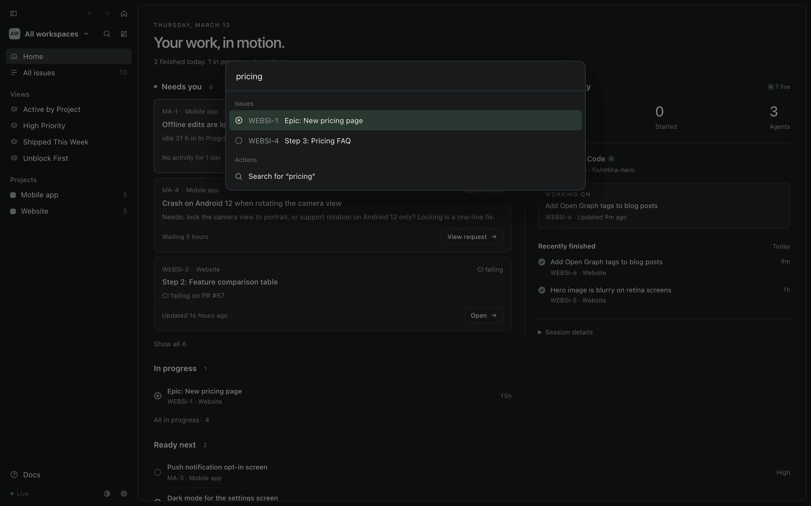
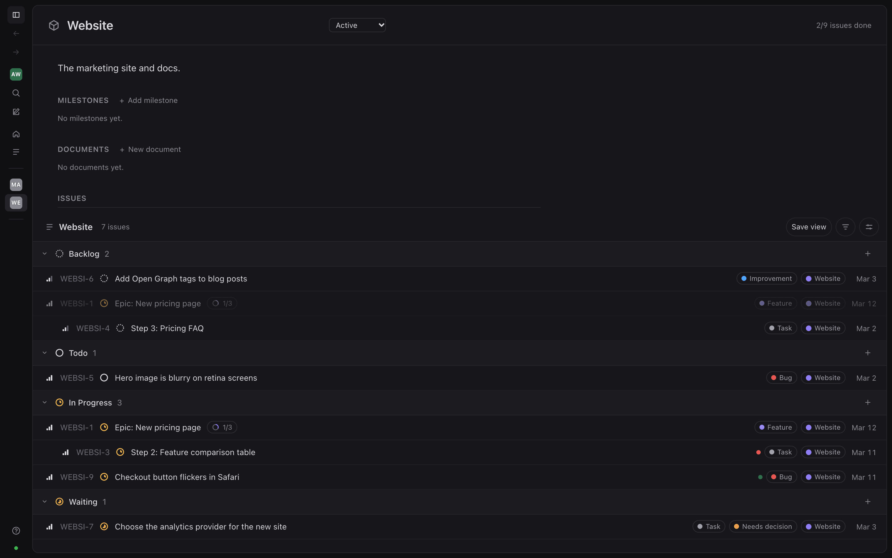

## Menu bar

The AI Task Tracking icon in the menu bar has:

- **Open AI Task Tracking**, **New Issue**, **Quick Capture…**
- the engine status and the backup status, and **Back Up Now**
- **Settings…** (⌘,), **Help** (these docs, in the app window), **Launch at Login**, **Quit AI Task Tracking**

It also lists the issues that need you, with a link to show them all on Home (Settings can hide them).

## Dock

The app also shows in the Dock and the app switcher by default. Clicking the Dock icon when no window is open opens
the window. Turn off **Settings ▸ Show in the Dock** to keep it in the menu bar only.

## Global shortcuts

Shortcuts work system-wide:

| Shortcut | Action | Other choices in Settings |
|---|---|---|
| ⌥⌘I | open the window | ⌃⌥⌘I, ⌥⌘T |
| ⌥⌘N | Quick Capture | ⌃⌥⌘N, ⌥⇧⌘N |

Change them or turn them off in Settings.

## Settings

Open with ⌘, or **Settings…** in the menu. Every change applies straight away.

- **General**: Launch at login; Show in the Dock; Show Needs-you issues in the menu; Show stalled work in Needs you
  (see [Stalled work](#stalled-work)); Show CI status (see [CI status](#ci-status-on-pull-requests)).
- **Notifications**: Notify me about agent activity, and for which events: an agent needs me (Waiting, Needs
  decision/review, stalled), an agent finished an issue (Done), an agent created an issue (off by default).
- **Shortcuts**: the two global shortcuts above.
- **Backup**: Back up to GitHub before quitting. When off, quitting still commits your changes; it just doesn't wait
  for the push.

## In the window

**Home** shows:

- *Needs you*: issues waiting for your decision or review, work that has [stalled](#stalled-work), and work whose
  [PR checks fail](#ci-status-on-pull-requests);
- *In progress*;
- *Ready next*;
- *Blocked*;
- a live feed of agent activity, each change tagged with the repo it came from.

All issues, projects and saved views are in the sidebar, as lists or boards. At the top of the sidebar:

- **←** and **→** go back and forward through this window's own history (its pages in the app), and are greyed out
  when there's nowhere to go there. ⌘[ / ⌘], the mouse side buttons and a two-finger swipe use the same history, and
  also cross between the docs pages and the app.
- **⌂** goes Home.
- the sidebar button on the left collapses the sidebar to icons, and expands it again. So do ⌘\ and
  **View ▸ Toggle Sidebar** in the app. Collapsed, each icon shows its name when you point at it; projects show their
  initials. The sidebar stays the way you left it, and collapses on its own in a narrow window.

**Docs** at the bottom of the sidebar, **Help ▸ AI Task Tracking Help** (⌘?) in the app's menu and **Help** in the
menu-bar menu open these docs, which the app serves at `http://127.0.0.1:7477/docs/`; from a terminal, `aitt docs`
opens them in the browser.


A project shows its description, milestones and documents above its issues, grouped by status:



An issue page has the description (checklists included), sub-issues, its attempts ("3 attempts · 2 tools": one per
agent session, which opens into each session's tool, repo, branch, writes and the status it left the issue in), the
activity with each agent's repo and branch, and the properties and relations on the right. Attempts start when this
Mac's activity log does (see [Picking up where a session stopped](/docs/guides/agent-sessions/#picking-up-where-a-session-stopped)):



| Key | Action |
|---|---|
| `c` | new issue |
| `/` or ⌘K | search |
| `g` then `h` | Home |
| `g` then `i` | all issues |
| ⌘[ / ⌘] | back and forward (also mouse side buttons and a two-finger swipe) |
| ⌘\ | collapse or expand the sidebar |





⌘K also switches the theme: type "theme" and pick one (see [Themes](/docs/guides/themes/)).

### Status icons

Every issue is a circle. An outline means the issue is open, a solid disc means it's closed, and the shape tells
you the status, so you can tell them apart even when a theme gives two statuses the same color.

| Icon | Status | Meaning |
|---|---|---|
| <svg width="16" height="16" viewBox="0 0 14 14" aria-hidden="true"><circle cx="7" cy="7" r="5.5" fill="none" stroke="currentColor" stroke-width="1.6" stroke-linecap="round" stroke-dasharray="0 2.88" transform="rotate(-90 7 7)"/></svg> | Backlog | a ring of dots: not committed to yet |
| <svg width="16" height="16" viewBox="0 0 14 14" aria-hidden="true"><circle cx="7" cy="7" r="5.5" fill="none" stroke="currentColor" stroke-width="1.5"/></svg> | Todo | an empty ring: committed, nobody on it yet |
| <svg width="16" height="16" viewBox="0 0 14 14" aria-hidden="true"><circle cx="7" cy="7" r="5.5" fill="none" stroke="currentColor" stroke-width="1.5"/><circle cx="7" cy="7" r="2.25" fill="currentColor"/></svg> | In Progress | a ring with a dot: someone is on it. Any started status you add gets this icon too |
| <svg width="16" height="16" viewBox="0 0 14 14" aria-hidden="true"><circle cx="7" cy="7" r="5.5" fill="none" stroke="currentColor" stroke-width="1.5"/><path d="M5.75 5.1v3.8M8.25 5.1v3.8" stroke="currentColor" stroke-width="1.5" stroke-linecap="round"/></svg> | Waiting | a ring with pause bars: stopped, it needs you. Every status listed under `needsYou.statuses` in `config.yml` (for example In Review) gets this icon |
| <svg width="16" height="16" viewBox="0 0 14 14" aria-hidden="true"><mask id="si-done"><rect width="14" height="14" fill="white"/><path d="M4.4 7.2 6.2 9 9.7 5.3" fill="none" stroke="black" stroke-width="1.5" stroke-linecap="round" stroke-linejoin="round"/></mask><circle cx="7" cy="7" r="6.25" fill="currentColor" mask="url(#si-done)"/></svg> | Done | a disc with a check: finished |
| <svg width="16" height="16" viewBox="0 0 14 14" aria-hidden="true"><mask id="si-canceled"><rect width="14" height="14" fill="white"/><path d="M4.6 7h4.8" stroke="black" stroke-width="1.5" stroke-linecap="round"/></mask><circle cx="7" cy="7" r="6.25" fill="currentColor" mask="url(#si-canceled)"/></svg> | Canceled | a disc with a dash: decided against |
| <svg width="16" height="16" viewBox="0 0 14 14" aria-hidden="true"><circle cx="8.6" cy="5.4" r="4.4" fill="none" stroke="currentColor" stroke-width="1.3" opacity=".75"/><circle cx="5.9" cy="8.1" r="4.9" fill="currentColor"/></svg> | Duplicate | a disc in front of a second circle: the same as another issue |

An issue with sub-issues also shows a **progress ring** and the count, such as
<svg width="14" height="14" viewBox="0 0 14 14" aria-hidden="true"><circle cx="7" cy="7" r="5.25" fill="none" stroke="currentColor" stroke-opacity=".18" stroke-width="2"/><circle cx="7" cy="7" r="5.25" fill="none" stroke="currentColor" stroke-width="2" stroke-linecap="round" stroke-dasharray="14.493 32.987" stroke-dashoffset="-1" transform="rotate(-90 7 7)"/></svg> 3/6,
in lists, on board cards, on the issue page and in a project's header. Point at it to read "3 of 6 sub-issues done".
The ring fills clockwise from 12 o'clock. Any progress shows at least a short arc, the ring stays open until every
sub-issue is closed, and it closes in the Done color when they all are. It's the only icon that fills up; the
issue's own status icon still tells you whether the issue itself is closed.

## Stalled work

Work can stall without anyone saying so: an agent session ends mid-task, or an issue keeps bouncing between agents.
The engine checks every open issue each time Home, the menu bar or an agent asks, and flags it as **stalled** when:

- **Idle**: it is *In Progress* and nothing changed on it (no edit and no comment, by anyone) for 24 hours or more.
  An epic's work happens in its children, so for an issue with sub-issues a change to any of them, at any depth,
  counts too. An epic whose open sub-issues all need you (Waiting, or a Needs-you label), are blocked, or are epics
  waiting the same way, is waiting on them, not idle.
- **Churning**: in the last 7 days it was reopened (back to *In Progress* from Done, Canceled, Duplicate, Todo or
  Backlog, after having been in progress before) 2 times or more, or more than 3 different agent sessions worked on it
  since it was last Done. Going to *Waiting* (or another Needs-you status) and back is an agent asking you, and never
  counts as a reopen.

Done, Canceled and Duplicate issues are never stalled, churning skips issues parked in *Backlog*, and an issue with an
open blocker stays in *Blocked*: it is waiting, not stalled. Any edit or comment clears *idle*. Done clears *stalled*
while the issue stays done, but reopening it counts as a reopen, so an issue that keeps coming back from Done can be
churning again at once; the count drops as the reopens age out of the 7 days.

A stalled issue joins **Home ▸ Needs you** with a red **STALLED** mark and the reason, such as
`idle 31 h in In Progress` or `reopened 3× in 7 days by 4 sessions`. If it already needed you (Waiting, or a Needs
label), it keeps that reason and gets the mark as well. On the Now/Next/Later board its card says *stalled*.

Agents see it too: in `whats_next` stalled issues stay in their usual list (*needsYou* still means waiting on you)
with `stalled: <reason>`, and a short `stalled` list shows the ones their repo worked on; `get_issue` includes
`stalled: <reason>`.

**Tune it** in the data folder's `config.yml` (the engine picks up the change at once):

```yaml
stalled:
  idleHours: 24   # In Progress with no change for this long; 0 turns idle off
  windowDays: 7   # how far back churning looks; 0 turns churning off
  reopens: 2      # back to In Progress this many times in the window; 0 turns it off
  sessions: 3     # more than this many agent sessions in the window without Done; 0 turns it off
```

The churning rules read the engine's activity log (`.tracker/events.jsonl`), which is kept on this Mac only; on a
fresh clone they start counting from then. All keys: [config.yml reference](/docs/reference/config/).

**In the app**, Settings ▸ **Show stalled work in Needs you** (on by default) decides whether stalled issues count in
the menu-bar number, appear in the menu's Needs-you list and send notifications ("Stalled: ATT-12", once per issue
until it stops being stalled; a round trip through Waiting doesn't notify again). Turned off,
the app leaves out issues that are there *only* because they stalled; Home in the window still marks them, so you can
look when you choose to.

## CI status on pull requests

When an issue links a GitHub pull request (agents add `PR #12` links when they mention a PR URL), the engine checks
that PR with your own `gh` and shows its state (**open**, **draft**, **merged**, **closed**) and its checks
(**passing**, **failing**, **running**, **no checks**):

- **The issue page**: under each PR link, a badge with the state, the checks, the names of up to three failing checks
  and when it was last checked. A merged PR whose checks failed reads **merged · checks failed**. A PR your `gh` can't
  read says *CI status: no access with gh* under its link.
- **Rows** in lists, boards and Home: a small dot on issues that have a PR, red when checks fail, amber while they run,
  green when they pass. Point at it for the PR number and state.
- **Home ▸ Needs you**: an *In Progress* issue, or one that reached *Done* in the last 7 days, whose open (or draft)
  PR's checks fail joins Needs you with the reason, such as `CI failing on PR #12`. A merged or closed PR never puts
  an issue in Needs you; its badge still shows how its checks ended.
- **Agents**: `get_issue` adds `ci: { state, checks, failing }` to each PR link, and `whats_next` marks those items
  with `ci: "CI failing on PR #12"`.

The engine checks in the background, never while you wait: an open PR every 2 minutes, and a new PR link within a
second. A merged PR whose checks passed (or that has none) and a PR closed without merging are checked once more,
then never again; a merged PR whose checks failed or still run is re-checked every 30 minutes until 24 hours after
the merge. It only looks at PRs on open issues and on issues that reached Done in the last 7 days, runs at most 3
`gh` calls at once, and backs off on errors and rate limits. Nothing is checked in the first 5 seconds after the
engine starts, so the app can pass its setting first. The results are kept in `.tracker/ci.json` on this Mac (not in
your issue files), so a restart doesn't check everything again. The engine finds `gh` on its PATH, or in
`/opt/homebrew/bin`, `/usr/local/bin` or `~/.local/bin` (the app started at login has a short PATH).

Without `gh`, or signed out, issues show no CI status and nothing else changes; the reason is in `/api/health`
(see [Troubleshooting](/docs/maintain/troubleshooting/)). A link your `gh` can't read only affects that link.

**Turn it off** with Settings ▸ **Show CI status** in the app, or `enabled: false` in `config.yml`. Either way the
engine stops running `gh`, and no badges or failing-CI Needs-you entries appear (the app passes its setting to the
engine, which is what runs `gh`). Running the engine without the app (`aitt serve`), only `config.yml` decides.
`refreshMinutes` sets how often open PRs are re-checked:

```yaml
ci:
  enabled: true
  refreshMinutes: 2
```

## Links to issues

Agents print issues as `[ATT-1 Title](http://127.0.0.1:7477/#/issue/ATT-1) · aitt://issue/ATT-1`. The `aitt://`
link opens the app. From a terminal, `aitt open ATT-1` (or a project slug, or either link) does the same, falling
back to the browser when the app isn't installed.
